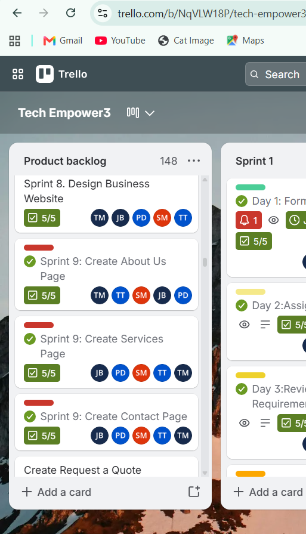
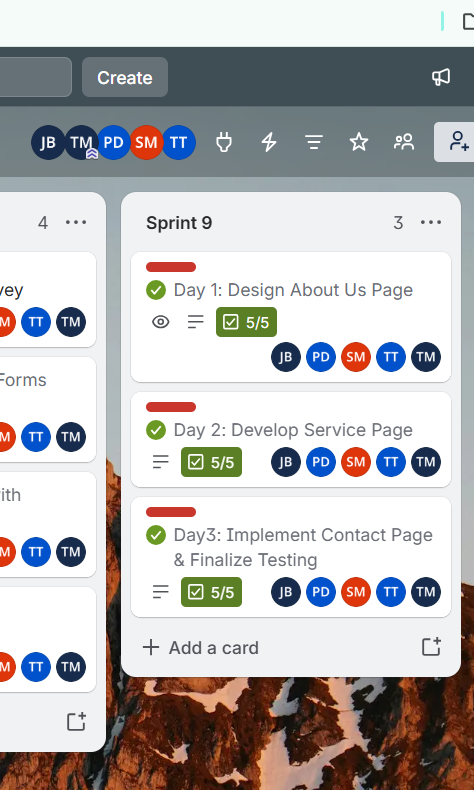

# Jabu-Mnguni
**Student |Diploma ICT in Communication Networks**

📧[221258639@mycput.ac.za](mailto:221258639@mycput.ac.za)  | 📞 +27 66 427 1216 | 📍 62 Bass Road, Belhar 6

---

## Profile Summary

Final year Information and Communication Technology student at Cape Peninsula University of Technology, specialising in communication networks. Seeking a WIL internship to strengthen practical experience in network administration, routing, switching, and IT support. Committed to learning, problem solving, and delivering efficient network solutions.

---

## Education

**Cape Peninsula University of Technology** | 2024 – Present
Diploma in ICT in Communication Networks

**Cape Peninsula University of Technology** | 2022
Higher Certificate in ICT

**Lesiba Secondary School** | 2018
Grade 12

---

## Technical Skills

- Network Simulation using Cisco Packet Tracer
- VLAN Configuration
- IP Addressing and Subnetting
- Command Line Networking Tools (ping, tracert, ipconfig)
- SQL Basics

---

## Projects

**Three-Layer Network Design (Cisco Packet Tracer)** | Oct 2025
*Cape Peninsula University of Technology*
- Designed a logical three-layer network topology (Core, Distribution, Access)
- Structured departmental segmentation using hierarchical design principles
- Applied network design concepts for scalability and organisation
- Created labelled network diagrams using Packet Tracer

**Packet Tracer – Implement Port Security** | Oct 2025
*Cape Peninsula University of Technology*
- Configured port security on switches to restrict access based on MAC addresses
- Tested security by connecting unauthorised devices and verifying restrictions
- Learned to prevent unauthorised access and secure switch ports in a LAN environment

**Cyber Security Challenge 2025 – Qualification Round (CTF)** | Sept 2025
*Cape Peninsula University of Technology*
- Participated in a competitive cybersecurity Capture The Flag challenge
- Worked in a team-based environment to solve security-related problems

---

## References

**Mr Xolani Mtshali** | Supervisor, Checkers | 0835749658

**Mr K.M. Tshabalala** | Principal, Lesiba Secondary School | 0825529065

---
###  Reflection on Coding in Markdown
* **Situation:** I needed to convert my professional CV into a web-ready format for my GitHub digital portfolio.
* **Task:** My goal was to use Markdown syntax to create a structured, readable, and professional layout that maintains hierarchy across different devices.
* **Action:** I implemented Markdown elements such as headers (`#`, `##`) for sectioning, used bold text for emphasis, and utilized code blocks to display technical details. I also ensured that contact information and video links were correctly hyperlinked.
* **Result:** I successfully created a clean, responsive digital presence. I learned how Markdown serves as an efficient tool for documentation and technical communication within the ICT industry.

---
## 🎥 Mock Interview Video
[Click here to watch my mock interview](https://github.com/Jabu-Mnguni/Jabu-Mnguni.github.io/blob/main/mockinterview.mp4)

---
###  Reflection on Mock Interview Video Experience
* **Situation:** As part of my work readiness training, I recorded a mock interview to simulate a real-world job application for a networking position.
* **Task:** The objective was to demonstrate technical knowledge and professional communication skills while identifying areas for improvement in my delivery.
* **Action:** I prepared by practicing responses using the STAR method for behavioral questions. During the recording, I focused on maintaining a professional tone and clearly articulating my experience with network design and security.
* **Result:** Reviewing the video helped me identify the need for a more measured speaking pace. This exercise increased my confidence in presenting my skills to potential employers during a formal interview.

---
###  Reflection on the Use of GitHub Pages
* **Situation:** To make my portfolio and work readiness evidence accessible to recruiters, I needed to host my repository as a live website.
* **Task:** My task was to deploy my project using GitHub Pages to create a functional, public-facing URL.
* **Action:** I configured the repository settings to enable GitHub Pages, ensuring the main branch was correctly indexed. I verified the deployment by testing the live links and ensuring the Markdown rendered properly as HTML.
* **Result:** My portfolio is now live and professionally presented. This process taught me the fundamentals of static site hosting and the importance of version control in managing a digital professional profile.

## Agile Team Charter

### 1. Evidence (Signed Charter Document)

### 1. Team Purpose & Vision
* **Why do we exist?:** To bridge the digital divide in under-resourced public high schools in Cape Town.
* **Team Mission:** We are solving the lack of functional computer labs and stable internet access for Grade 8-12 learners in communities such as Khayelitsha, Mitchell's Plain, and Gugulethu.
* **Success Definition:** Success is achieved when learners gain digital skills for university and employment, verified by their ability to use modern tools effectively.
* **Product/Service:** Mobile digital learning services providing hardware, internet, and structured IT training (Microsoft Word, PowerPoint, coding).

---

### 2. Team Members & Roles

| Name | Role | Key Responsibilities |
| :--- | :--- | :--- |
| **Tumelo Gabriel Masilela** | Product Owner / Team Leader | Vision, backlog prioritization, and stakeholder management. |
| **Jabu Mnguni** | Agile Lead / Researcher| Facilitating ceremonies, removing blockers, and data research. |
| **Tiisetso Tukane** | Developer / Writer | Content creation, documentation, and technical writing. |
| **Siphesihle Mkiva** | Designer | UX/UI design for training modules and mobile lab setups. |
| **Pule Dzavana** | Tester / Presenter | System testing and presenting progress to schools. |

---

### 3. Ways of Working

#### 3.1 Agile Framework
* **Kanban:** We use Trello as our primary visual tool to manage workflow and track tasks from backlog to completion.

#### 3.2 Ceremonies

| Ceremony | Frequency | Purpose |
| :--- | :--- | :--- |
| **Daily Stand-up** | Daily (15 min) | Sync on Trello board status and address immediate blockers. |
| **Planning** | Every 2 Weeks | Prioritize new school targets or training module development. |
| **Review / Demo** | End of Sprint | Demonstrate completed digital skills modules or hardware setups. |
| **Retrospective** | End of Sprint | Discuss team performance and how to improve collaboration. |

---

### 4. Working Agreements
* Be punctual for all ceremonies.
* Update Trello cards in real-time as status changes.
* Follow the "Definition of Done" before moving any card to the final column.

---

### 5. Communication
* **Primary Channels:** WhatsApp (Urgent syncs) and Trello (Project tracking/Task assignment).
* **Response-time:** 4 hours during school hours; Trello notifications must be checked once daily.
* **Remote Norms:** Cameras on during Review/Retrospective; documents stored on Microsoft Teams/Google Drive.

---

### 6. Decision-Making
* **Method:** Decisions within "Tech Empower" are made through a consensus-based model where possible.
* **Role-Based Decisions:** Small technical decisions are made by the specific role-owner (e.g., Siphesihle for design choices).
* **Team-Wide Decisions:** Major changes to project scope or training content require a majority vote during Planning sessions.
* **Tie-Breaking:** In the event of a deadlock, the Team Leader (Tumelo) has the final authority to ensure project momentum.

---

### 7. Definition of Done (DoD)
Work is "Done" when:
* The Trello card is in the "Done" column.
* All documentation is attached to the card.
* The Product Owner has reviewed and added a "Final Approval" comment.

---

### 8. Core Values & Behaviours
* **Transparency:** Keeping the Trello board accurate so everyone knows the project status.
* **Accountability:** Every card must have an owner responsible for its completion.
* **Respect:** Valuing the technical expertise of all five team members.

---

### 9. Risks & Constraints
* **Known Risks:** Equipment security and inconsistent school schedules.
* **Constraints:** Academic year deliverables and limited budget for mobile data.

---

### 10. Review & Improvement
* **Frequency:** This charter is reviewed at the end of every Sprint Retrospective to ensure our ways of working evolve with the team's needs.
* **Improvement:** Any team member can propose an update to our working agreements during the retrospective session.

---

### 11. Team Commitment
By working on this team, we commit to the principles and agreements outlined above.

| Name | Student Number |
| :--- | :--- |
| **Tumelo Gabriel Masilela** | 222335726 |
| **Jabu Mnguni** | 221258639 |
| **Tiisetso Tukane** | 222206616 |
| **Siphesihle Mkiva** | 219462593 |
| **Pule Dzavana** | 222018437 |

### 12. Reflection
> **Reflection:**  
> Co-creating this Team Charter established a shared foundation for the "Tech Empower3" project, giving every team member absolute clarity on our mission to bridge the digital divide in Cape Town. Defining our core roles, structured ceremonies, and explicit "Definition of Done" ensured seamless collaboration, mutual accountability, and professional alignment across every stage of our website development.

## User Stories and Tasks

### 1. Evidence (User Stories Table)

| User Story ID | As a... (User Role) | I want to... (Action/Goal) | So that... (Benefit/Value) | Associated Tasks |
| :--- | :--- | :--- | :--- | :--- |
| **US01** | Site Visitor / Client | View the **Services** and **Products** pages detailing our mobile digital learning offerings | I can understand what hardware, internet, and IT training services are available. | • Create Services Page • Create Products Page • Add descriptive copywriting |
| **US02** | Prospective Partner | Navigate to the **About Us** page to read our team mission and vision | I know who is behind the initiative and our commitment to high schools | • Create About Us Page • Outline community goals |
| **US03** | Interested Client | Use the **Contact Page** to send a direct message or inquiry | I can easily reach out to book or partner with Tech Empower | • Create Contact Page • Implement inquiry form functionality |

### 2. Reflection
> **Reflection:**  
> Breaking down the website development into user stories based on specific pages (About Us, Services and Contact) ensured our design remained completely user-centric. This modular approach allowed us to map individual tasks directly onto our Trello backlog, ensuring every page served a clear purpose for prospective clients

## Product Backlog

### 1. Evidence

* **Core Product Backlog Items:**
  * Sprint 9: Create About Us Page
  * Sprint 9: Create Services Page
  * Sprint 9: Create Contact Page

### 2. Reflection
> **Reflection:**  
> Maintaining a master Product Backlog on Trello allowed us to map out the entire website structure—including the About Us, Products, Services, and Contact pages. Prioritizing these items ensured that we had a clear, overarching master list of all required deliverables before breaking them down into active development cycles, preventing scope creep and keeping our business goals focused.

## Sprint Backlog
### 1. Evidence

* **Active Sprint (Sprint 9: Website Pages Development):**
  * **Day 1:** Design & Build Homepage & About Us Page
  * **Day 2:** Develop  Services Pages
  * **Day 3:** Implement Contact us Page & Finalize Testing

### 2. Reflection
> **Reflection:**  
> Breaking down our website development into structured daily tasks during Sprint 9 allowed the team to deliver specific website pages (About Us,  Services, and Contact us) incrementally. Using checklist criteria for each card ensured high quality, thorough testing, and steady progress toward building our business marketing platform.

## Agile Logbook

### 1. Evidence (Daily Standup & Sprint Progress Log)

| Date / Sprint | Team Member | Daily Activity / Task Completed | Blockers / Challenges | Resolution |
| :--- | :--- | :--- | :--- | :--- |
| **Sprint 9 - Day 1** | Siphesihle Mkiva & pule dzavana  | Built the About Us page, drafting the company mission and team profiles. | Deciding on final color scheme and brand messaging. | Agreed on responsive, high-contrast theme focused on mobile learning. |
| **Sprint 9 - Day 2** |Siphesihle Mkiva & tissetso tukane  | Built Products & Services pages highlighting hardware, internet, and IT training packages. | Formatting product cards for small screen sizes. | Used CSS Flexbox/Grid for mobile responsiveness. |
| **Sprint 9 - Day 3** | jabu mnguni & tumelo masilela & siphesihle mkiva | Created Contact Page with inquiry form and conducted end-to-end site testing. | Contact form styling alignment. | Fixed form input padding and verified submission layout. |

### 2. Reflection
> **Reflection:**  
> Maintaining an Agile Logbook allowed us to track daily accountability and quickly surface blockers during sprint cycles. Transparent tracking ensured seamless communication across the team, keeping our website development on schedule for final submission.
